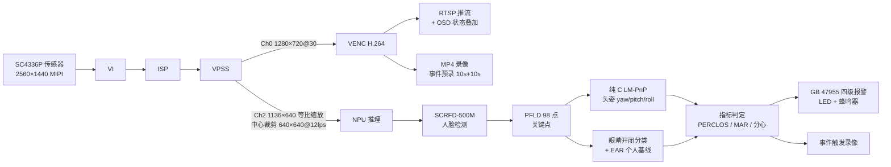

# Hi3516CV610 DMS — 边缘端驾驶员监测系统

基于海思 Hi3516CV610（20S，1 TOPS NPU）的驾驶员监测系统（DMS）：疲劳检测（闭眼/PERCLOS/哈欠）+ 分心检测（纯 C PnP 头姿估计），按 GB 47955 四级报警链输出声光报警与事件录像。全部算法判定逻辑为手写 C 代码，模型仅负责感知输出。

## 系统数据流



## 演示

<!-- TODO: VLC 拉流截图（带 OSD 状态文字）或演示动图放这里 -->

## 性能数据（Hi3516CV610 20S 实测）

`APP_DMS_PROFILE=1` 编译上板运行，串口每 5s 输出一行 `dms_prof`：

| 指标 | 实测值 |
|---|---|
| DMS 线程帧率 | [X] fps |
| 单帧总耗时 | [X] ms |
| 进程 CPU 占用 | [X] % |

## 自研模块（核心代码，均为手写 C 实现）

| 文件 | 内容 |
|---|---|
| `video/mp4_writer.c` | ISOBMFF（MP4）封装器：box 结构、样本表、时间戳管理，不依赖第三方库 |
| `video/rtsp_server.c` | RTSP/RTP 推流服务：会话协商、H.264 FU-A 分片打包 |
| `dms/dms_clip.c` | 事件预录：4MB 静态环形内存池，前 10s + 后 10s 事件片段 |
| `dms/dms_models.c` | 纯 C 实现 Levenberg-Marquardt PnP：98 点关键点 → 头姿角（解析雅可比，手写求解器） |
| `dms/dms_alert.c` | 声光报警驱动：/dev/mem 直接写寄存器做 pinmux 复用 + PWM 蜂鸣器、GPIO LED |

## 功能

- **疲劳检测**：闭眼判定（眼分类器 + EAR 个人基线联合）、长闭眼（400ms）、PERCLOS（60s 窗口，0.15 阈值带回差）、哈欠检测（MAR，板端实测标定阈值 0.25）
- **分心检测**：纯 C PnP 头姿估计，相对个人姿态基线判定（|yaw|>30° 或 pitch<−20° 持续 3.5s），带退出回差与 2000ms 复位延时防抖
- **报警链**：按 GB 47955 四级时序（NOTICE → WARNING → DCA → RMF），LED（GPIO）+ 蜂鸣器（PWM）声光报警
- **视频链路**：VI → ISP → VPSS（Ch0 录像/RTSP、Ch2 DMS）→ VENC H.264，RTSP 推流、MP4 录像、事件触发预录
- **模型**：SCRFD-500M 人脸检测 + PFLD 98 点关键点 + 眼睛开闭分类，ATC 转换为 .om 在 NPU 上推理（模型文件不在仓库内）

## 目录结构

- `main.c` — 程序入口
- `app_config.h` — 全部参数与开关集中配置
- `video/` — 视频主链路（采集、VPSS、编码、OSD、RTSP、MP4）
- `dms/` — DMS 主体（线程、模型推理、指标判定、报警、事件录像）
- `npu/` — NPU 模型加载与推理封装
- `函数速查.md` — 代码阅读顺序与函数速查

## 构建

需要海思 Hi3516CV610 SDK 与 ARM 交叉编译工具链（Linux 容器内执行）：

```bash
make
# 打开性能统计（每 5s 打印各步耗时）
make EXTRA_DEFS=-DAPP_DMS_PROFILE=1
```

模型文件（.om）需用 ATC 转换后放到板端 `/mnt/sd/nfs/dms/` 下，不在仓库内。
